# Evidencias individuales · StockFlow

Evidencias de pruebas, arquitectura y base de datos del sistema StockFlow.
Las pruebas se ejecutaron el 20-11-2026 sobre la versión del repositorio en la rama `main`.

**Contenido**

1. [Resultados de ejecución de pytest](#1-resultados-de-ejecución-de-pytest)
2. [Casos de prueba automatizados](#2-casos-de-prueba-automatizados)
3. [Casos de prueba manuales](#3-casos-de-prueba-manuales)
4. [Arquitectura en capas](#4-arquitectura-en-capas)
5. [Modelo relacional y esquema físico](#5-modelo-relacional-y-esquema-físico)
6. [Archivos de respaldo](#6-archivos-de-respaldo)

---

## 1. Resultados de ejecución de pytest

Ejecución de la suite completa desde el panel *Testing* de VS Code: **36 de 36 pruebas aprobadas**.

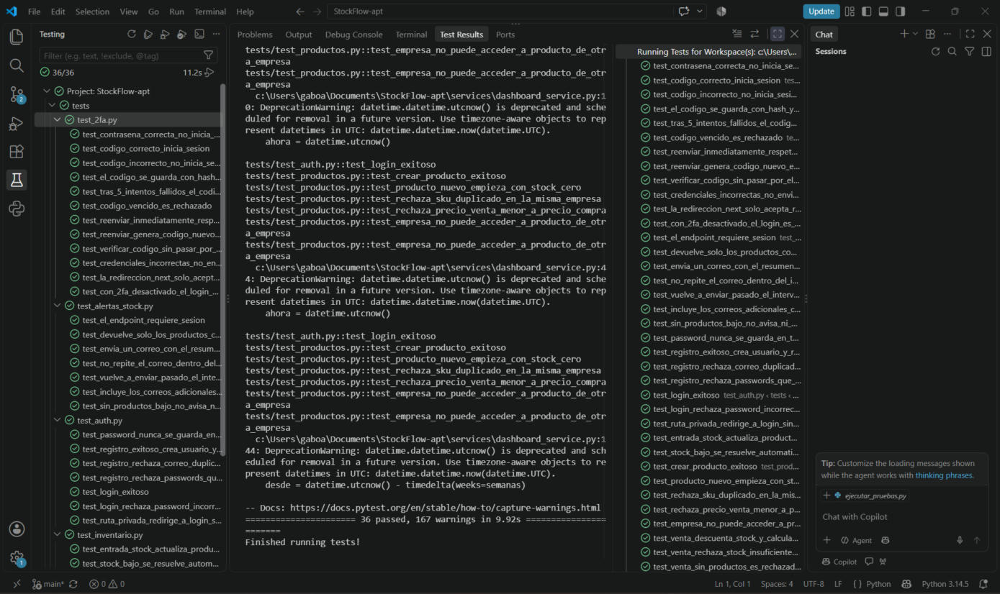

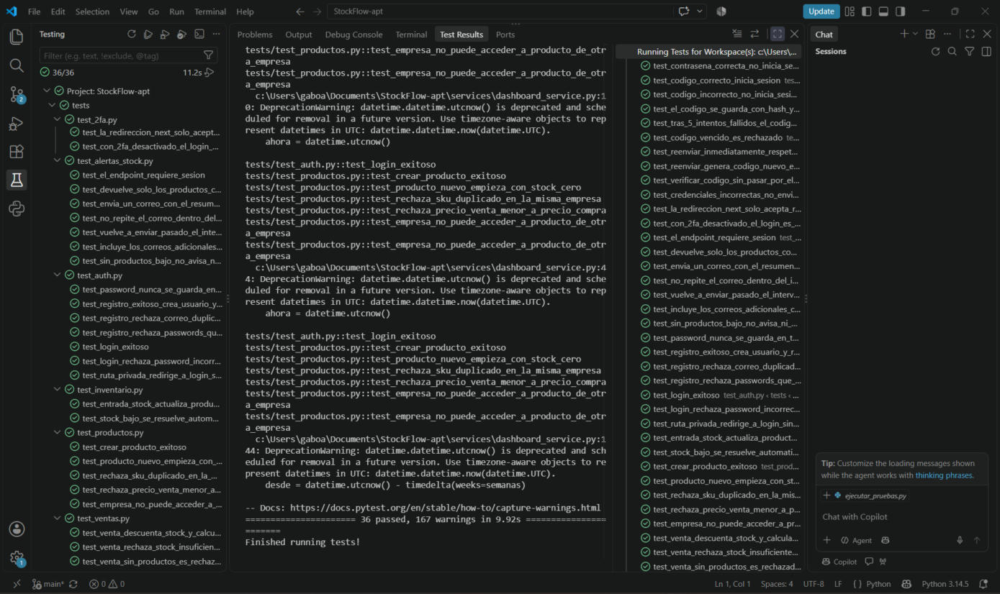

## 2. Casos de prueba automatizados

Los 36 casos de `tests/`, con su resultado esperado y el resultado real de la ejecución.

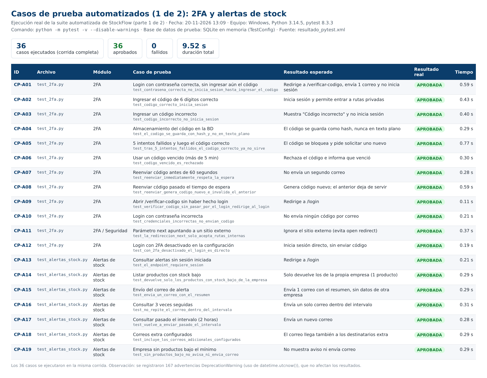

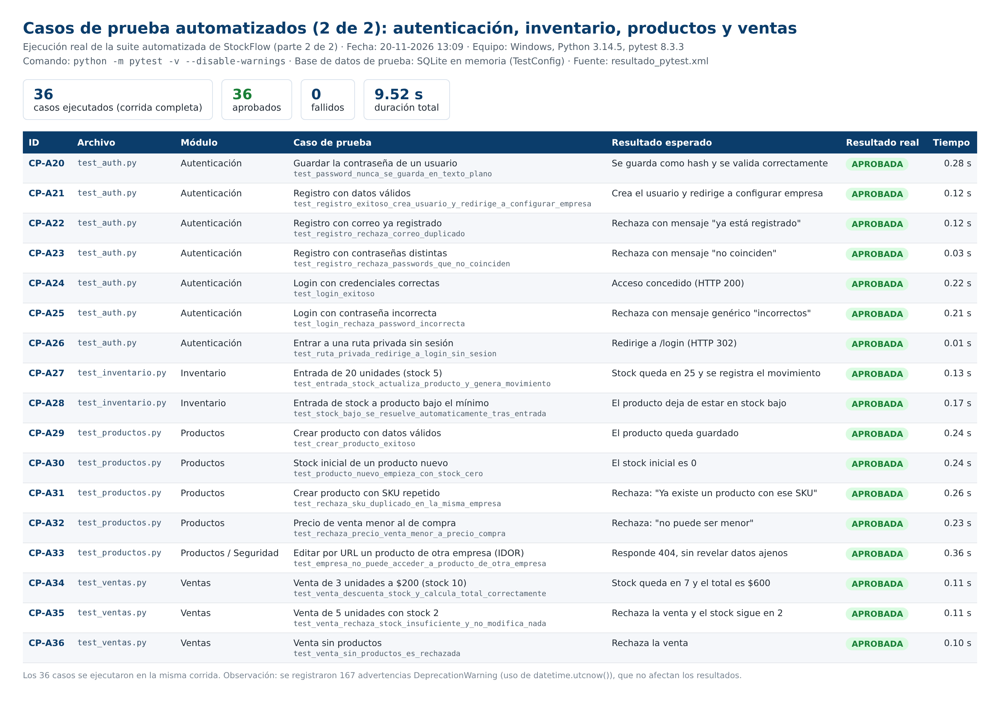

## 3. Casos de prueba manuales

Los 21 casos de `tests/CASOS_DE_PRUEBA.md`, ejecutados en la aplicación con el resultado real obtenido.

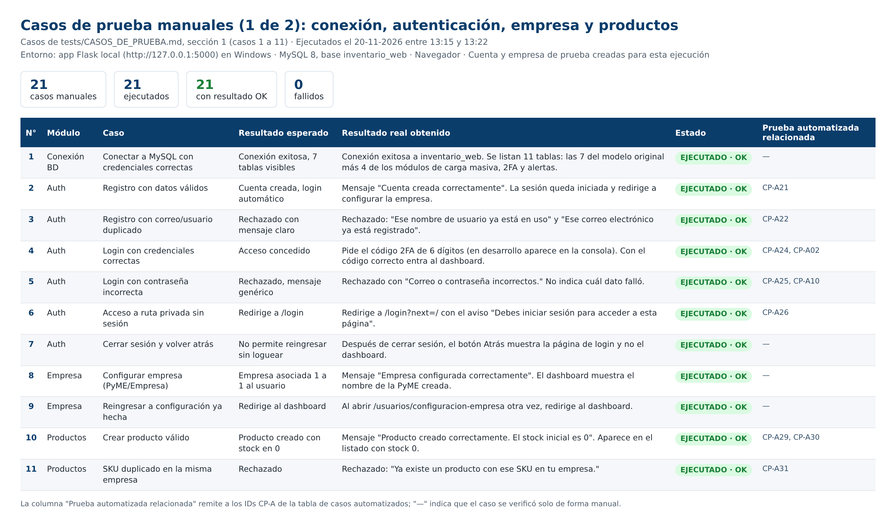

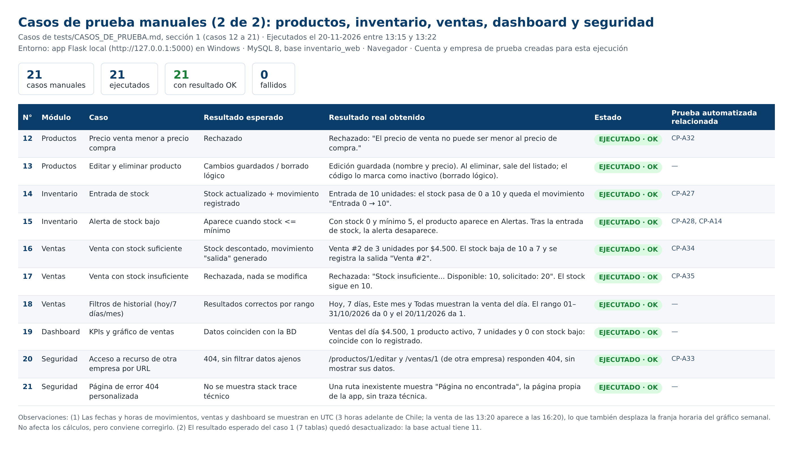

Caso 1: conexión exitosa a la base de datos `inventario_web` (11 tablas).

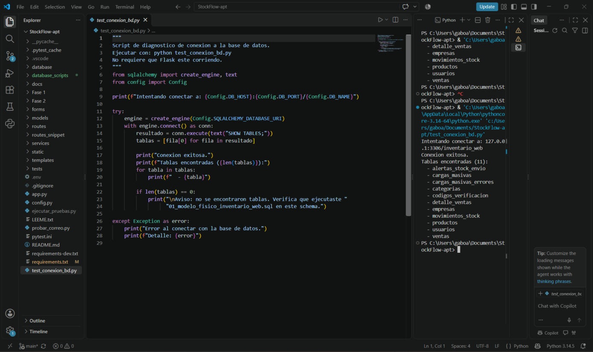

## 4. Arquitectura en capas

Comunicación entre el navegador, Flask, la capa de presentación, el middleware de seguridad, los blueprints, los servicios, los modelos SQLAlchemy y MySQL.

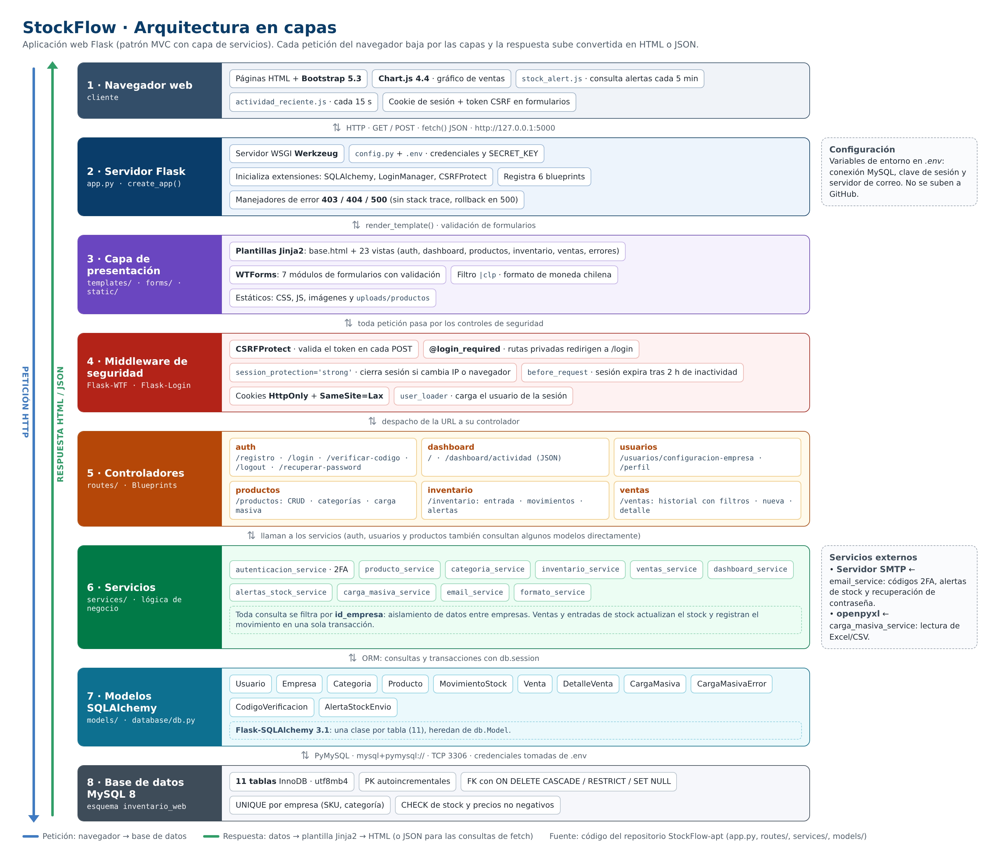

## 5. Modelo relacional y esquema físico

Diagrama EER generado con MySQL Workbench por ingeniería inversa de la base `inventario_web`.

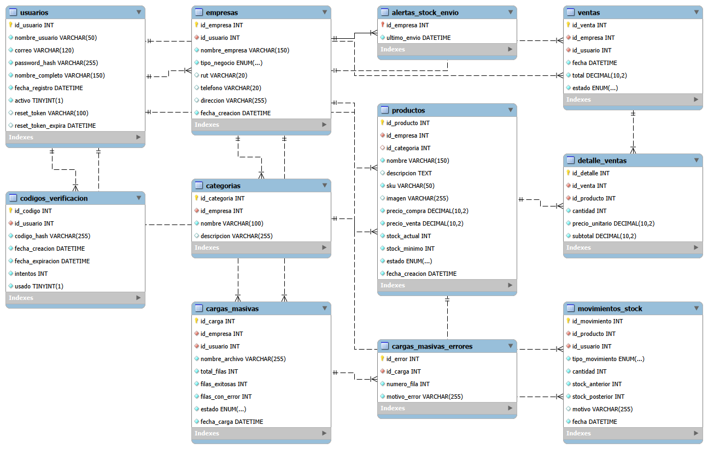

Modelo relacional con claves primarias, claves foráneas, cardinalidades y reglas `ON DELETE`.

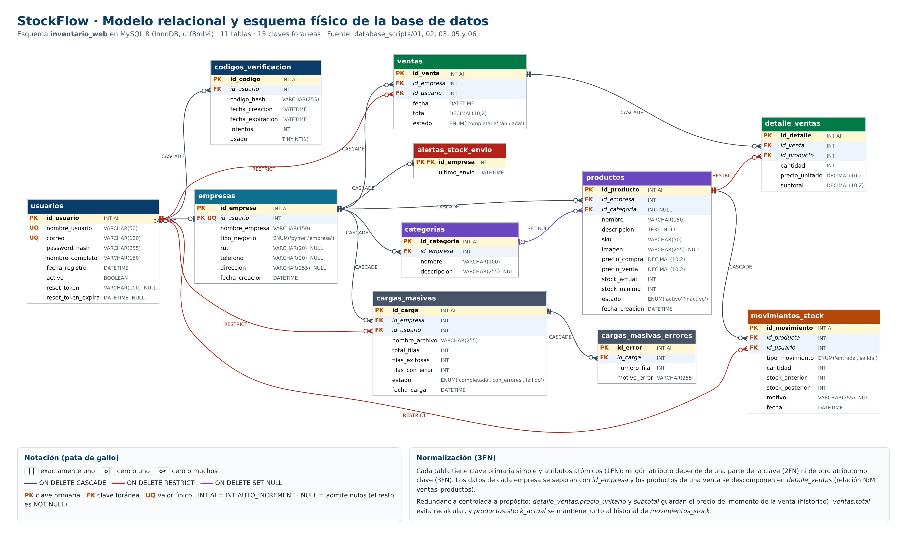

Esquema físico: claves primarias, claves foráneas, restricciones `UNIQUE`, `CHECK` e índices de cada tabla.

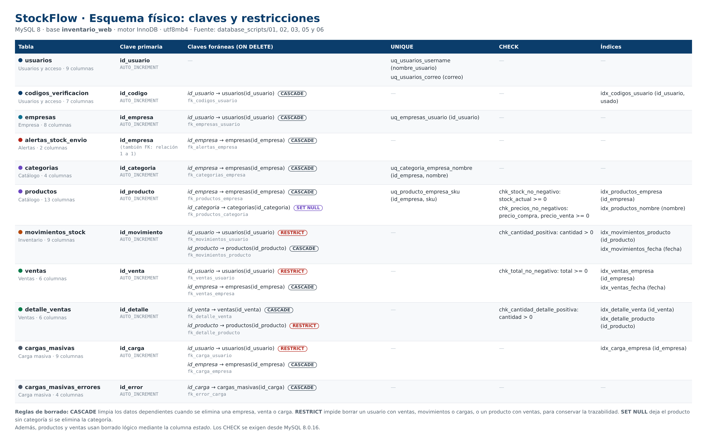

## 6. Archivos de respaldo

| Archivo | Contenido |
|---|---|
| [`resultado_pytest.txt`](resultado_pytest.txt) | Salida de texto de `pytest -v` |
| [`resultado_pytest.xml`](resultado_pytest.xml) | Resultado en formato JUnit XML |
| [`resultado_pytest_con_avisos.txt`](resultado_pytest_con_avisos.txt) | Salida completa, incluidas las advertencias |
| [`modelo_inventario_web.mwb`](modelo_inventario_web.mwb) | Modelo de MySQL Workbench (se abre con Workbench 8.0) |

Otra evidencia de la carpeta:

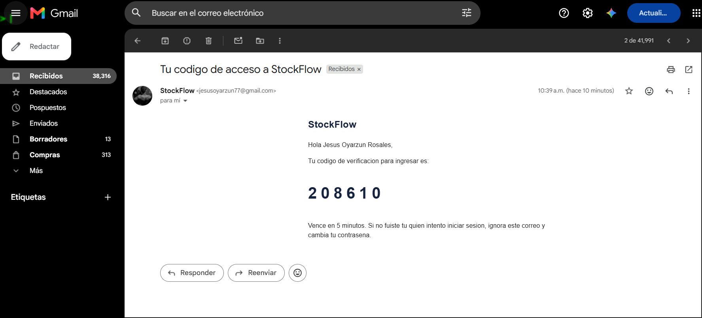
